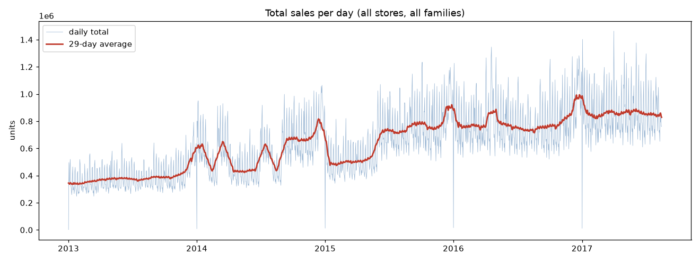
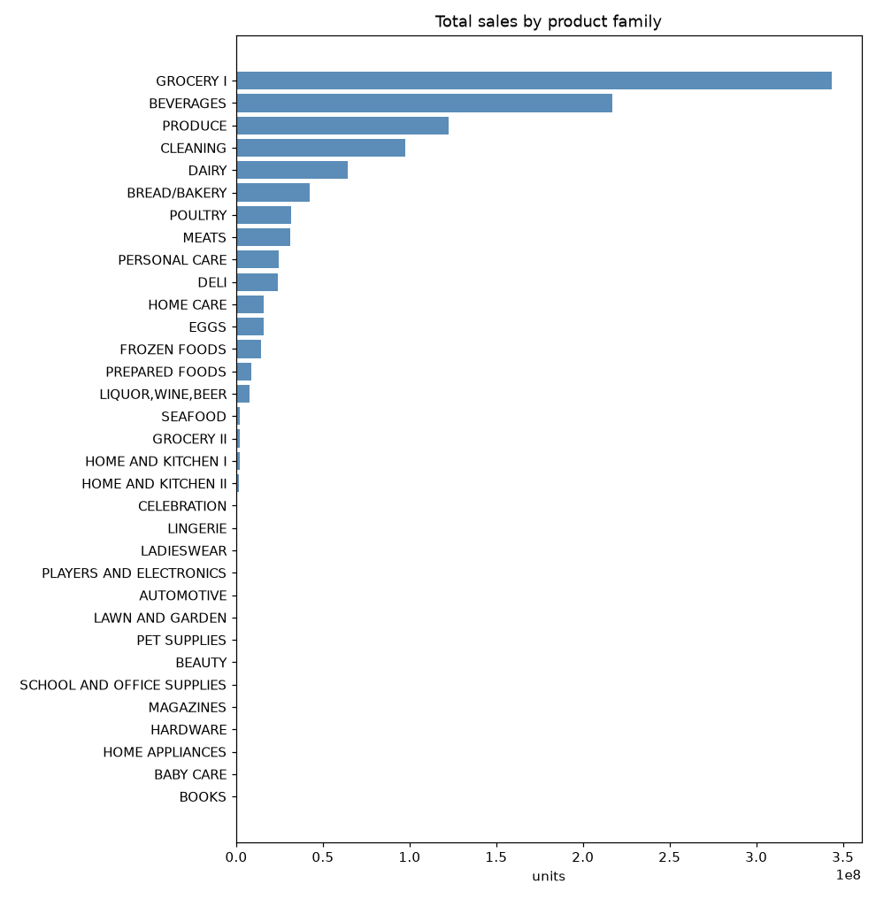
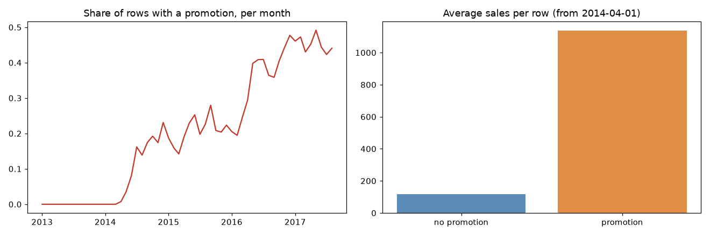
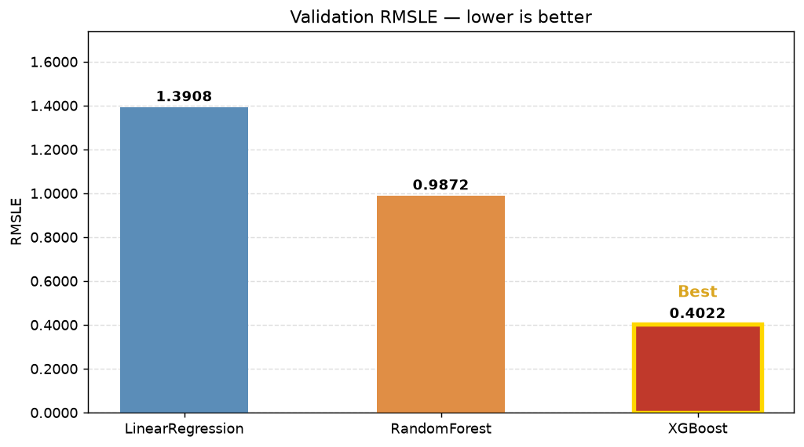
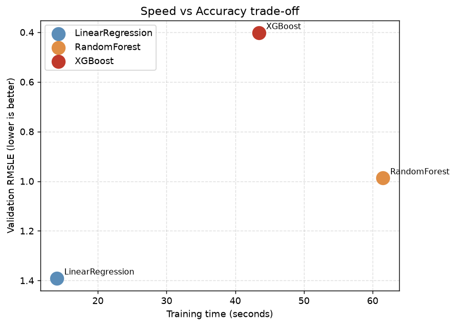
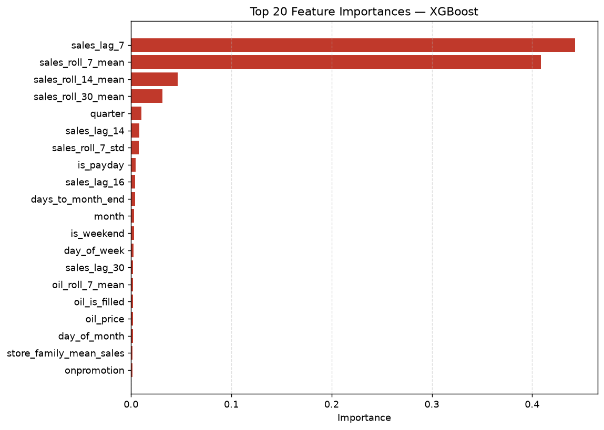
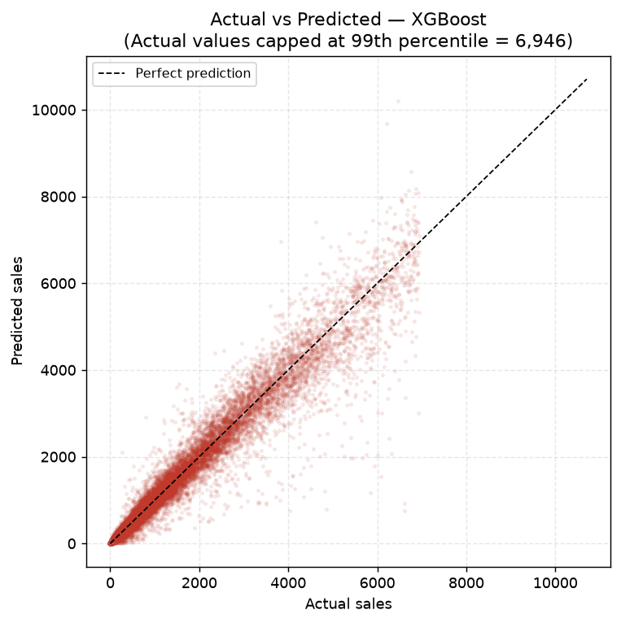
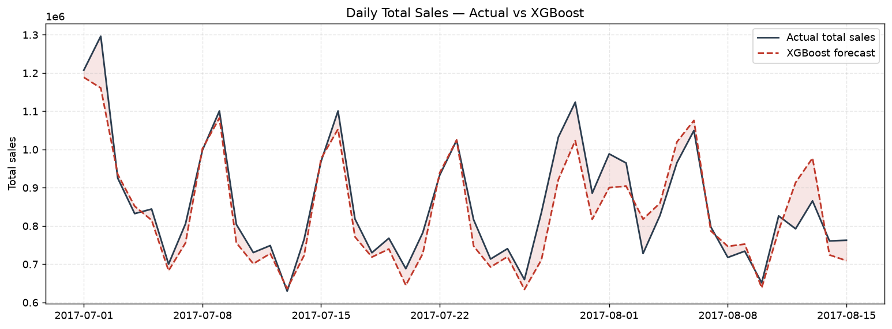

# stockwise-ai
# StockWise AI — Store Sales Forecasting

An end-to-end Machine Learning project for analyzing retail sales data, engineering time-series features, training multiple regression models, and comparing their forecasting performance.

StockWise AI uses historical sales, store information, promotions, oil prices, calendar information, and holidays to predict daily sales for different product families across multiple stores.

---

## Table of Contents

- [Project Overview](#project-overview)
- [The Problem](#the-problem)
- [Dataset](#dataset)
- [Project Workflow](#project-workflow)
- [Data Processing](#data-processing)
- [Exploratory Data Analysis](#exploratory-data-analysis)
- [Feature Engineering](#feature-engineering)
- [Model Training](#model-training)
- [Model Evaluation](#model-evaluation)
- [Results](#results)
- [Project Structure](#project-structure)
- [Installation](#installation)
- [How to Run the Project](#how-to-run-the-project)
- [Generated Outputs](#generated-outputs)
- [Important Technical Decisions](#important-technical-decisions)
- [Current Limitations](#current-limitations)
- [Technologies Used](#technologies-used)

---

## Project Overview

StockWise AI is a retail sales forecasting project built using Python and Machine Learning.

The project follows a complete data science workflow:

1. Raw data inspection.
2. Data cleaning and validation.
3. Exploratory Data Analysis (EDA).
4. Feature engineering.
5. Training multiple Machine Learning models.
6. Model evaluation and comparison.
7. Saving the best trained model.
8. Generating reports and visualizations.

The main goal is not just to train a model, but to build a structured and reproducible pipeline in which every stage has a clear responsibility.

## The Problem

Retail businesses need to estimate future product demand to make better decisions about:

- Inventory management.
- Product availability.
- Stock replenishment.
- Promotion planning.
- Sales forecasting.

For example, imagine a store that sells beverages, groceries, cleaning products, and other product categories.

The store needs to estimate how many units of each product category customers may buy tomorrow or in the coming days.

Historical sales alone may not be enough. Demand can also be affected by:

- The day of the week.
- Seasonal patterns.
- Promotions.
- Holidays and special events.
- Store characteristics.
- Previous sales behavior.
- External economic indicators such as oil prices.

StockWise AI explores these relationships and uses them to build forecasting models.

## Dataset

This project uses the **Store Sales - Time Series Forecasting** dataset from Kaggle.

Dataset source:

[Kaggle — Store Sales - Time Series Forecasting](https://www.kaggle.com/competitions/store-sales-time-series-forecasting)

The dataset contains historical sales information from Favorita stores in Ecuador.

### Dataset overview

| Property | Value |
|---|---:|
| Number of training rows | 3,000,888 |
| Number of stores | 54 |
| Number of product families | 33 |
| Training date range | 2013-01-01 to 2017-08-15 |
| Number of distinct training dates | 1,684 |
| Test rows | 28,512 |
| Test date range | 2017-08-16 to 2017-08-31 |

Each training row represents the sales of one product family in one store on a particular date.

### Dataset files

| File | Description |
|---|---|
| `train.csv` | Historical sales data, including the target variable |
| `test.csv` | Dates and store/product combinations requiring predictions |
| `stores.csv` | Store information such as city, state, type, and cluster |
| `oil.csv` | Daily oil price information |
| `holidays_events.csv` | Holidays, events, and transferred holidays |
| `transactions.csv` | Number of transactions per store and date |
| `sample_submission.csv` | Example Kaggle submission format |

### Main target variable

The target variable is:

` sales `

It represents the number of units sold for a particular product family in a particular store on a particular day.

The project predicts this value using historical and engineered features.

### Where to put the data

Download the Kaggle dataset and extract the required files into:

```text
data/
└── raw/
    ├── train.csv
    ├── test.csv
    ├── stores.csv
    ├── oil.csv
    ├── holidays_events.csv
    ├── transactions.csv
    └── sample_submission.csv
```

The raw and processed datasets are excluded from Git to avoid uploading large data files.

## Project Workflow

The project is organized into independent Python scripts.

Each script performs a specific stage of the pipeline.

```text
Raw Data
   |
   v
Data Inspection
   |
   v
Data Cleaning
   |
   v
Data Validation
   |
   v
Exploratory Data Analysis
   |
   v
Feature Engineering
   |
   v
Model Training
   |
   v
Model Comparison
   |
   v
Best Model + Reports + Visualizations
```

## Data Processing

The first stage prepares the raw data for analysis and Machine Learning.

### 1. Raw Data Inspection

Script:

`src/inspect_data.py`

This script examines the original CSV files before any cleaning takes place.

It checks:

- Dataset dimensions.
- Column names and data types.
- Missing values.
- Duplicate rows.
- Date ranges.
- Sales distributions.
- Store and product information.
- Data consistency.

The results are saved in:

`reports/inspection_report.txt`

### 2. Data Cleaning and Preparation

Script:

`src/prepare_data.py`

This stage combines the original datasets and creates cleaned datasets.

#### Store information

The store metadata is joined using `store_nbr`.

It adds:

- City.
- State.
- Store type.
- Store cluster.

The original `type` column is renamed to `store_type` to avoid confusion with holiday types.

#### Oil price processing

Oil prices are not available for every calendar day.

The project:

1. Creates a complete daily calendar.
2. Carries the last known oil price forward.
3. Fills leading missing values using the first available real price.
4. Adds `oil_is_filled` to identify filled values.

This preserves information about whether an oil price was observed or estimated.

#### Holiday processing

Holiday records are classified into different categories:

- Real holidays.
- Events.
- Work days.
- Transferred holidays.

A transferred holiday is not treated as a day off on its original date.

The project also distinguishes national, regional, and local holidays.

#### Quality-control flags

Instead of deleting unusual or zero-sales rows, the project creates quality-control flags:

| Flag | Meaning |
|---|---|
| `qc_zero_series` | The store/product series has never recorded a sale within the statistics window |
| `qc_before_first_sale` | The date is before the first recorded sale |
| `qc_store_closed_day` | The store recorded zero sales across all product families that day |
| `qc_sales_outlier` | The sale exceeds the series-specific outlier threshold |

Outliers are identified using the Interquartile Range (IQR) method:

\[
Upper\ Limit = Q3 + 3 \times IQR
\]

These flags are retained for analysis and training filters. The original sales values are not removed or modified.

### 3. Data Validation

Script:

`src/validate_data.py`

The validation stage independently checks the cleaned datasets against the original data.

It verifies:

- Row counts.
- Unique IDs.
- Date consistency.
- Store and product combinations.
- Missing values.
- Oil price filling.
- Holiday flags.
- Quality-control flags.
- Test dataset structure.

The validation report uses three statuses:

- `PASS`: The check passed.
- `WARN`: An unusual condition requires attention.
- `FAIL`: A real validation problem was found.

The latest saved validation report contains:

| Result | Count |
|---|---:|
| PASS | 64 |
| WARN | 1 |
| FAIL | 0 |

The report is available at:

`reports/validation_report.txt`

## Exploratory Data Analysis

Script:

`src/eda.py`

Exploratory Data Analysis (EDA) means studying and visualizing the dataset before building predictive models.

The project analyzes:

1. Total sales over time.
2. Average sales by weekday.
3. Sales by day of the month.
4. Sales by product family.
5. Sales by store.
6. Promotion behavior.
7. Holidays and events.
8. The 2016 earthquake period.
9. Zero-sales behavior by product family.

### Example: Total sales over time



### Example: Sales by product family



### Example: Promotion analysis



### Some observations

The EDA report identifies several patterns:

- Average daily sales increased substantially between 2013 and 2016.
- Weekends recorded approximately 39% more sales than weekdays.
- The three largest product families account for approximately 64% of total units sold.
- The 10 largest stores account for approximately 40% of total sales.
- Promotion information starts on 2014-04-01.
- December 25 has no sales rows because stores are closed.

The complete analysis is saved in:

`reports/eda/eda_notes.md`

## Feature Engineering

Script:

`src/feature_engineering.py`

Feature engineering is the process of transforming raw information into useful variables that Machine Learning models can learn from.

The project creates 38 model features divided into several groups.

### 1. Calendar Features

These features describe the date:

- `day_of_week`
- `day_of_month`
- `week_of_year`
- `month`
- `quarter`
- `year`
- `is_weekend`
- `days_to_month_end`
- `is_payday`

They help models learn weekly, monthly, and seasonal patterns.

### 2. Sales Lag Features

A lag feature represents a previous value of the target variable.

For example:

- `sales_lag_7`: Sales from 7 calendar days earlier.
- `sales_lag_14`: Sales from 14 calendar days earlier.
- `sales_lag_16`: Sales from 16 calendar days earlier.
- `sales_lag_30`: Sales from 30 calendar days earlier.

These features help the model understand historical demand.

### 3. Rolling Statistics

Rolling features summarize previous observations over a time window.

Examples:

- `sales_roll_7_mean`
- `sales_roll_14_mean`
- `sales_roll_30_mean`
- `sales_roll_7_std`

The rolling mean represents the average sales over the previous period.

The rolling standard deviation represents how much sales fluctuate.

The current day's sales are excluded from these calculations.

### 4. Promotion Features

Promotion-related features include:

- `onpromotion`
- `promo_lag_7`
- `promo_roll_7_mean`

They help the models understand the relationship between promotions and demand.

### 5. Oil Features

Oil-related features include:

- `oil_price`
- `oil_is_filled`
- `oil_lag_7`
- `oil_roll_7_mean`

### 6. Categorical Encoding

Machine Learning algorithms generally require numerical inputs.

The project converts categorical variables into numerical representations:

- `store_type_enc`
- `family_enc`
- `city_enc`
- `state_enc`

It also creates:

`store_family_mean_sales`

This feature represents historical sales behavior for each store/product-family combination.

### Avoiding Data Leakage

Data leakage occurs when a model receives information that would not have been available at prediction time.

To reduce leakage:

- Training statistics are calculated using the training period only.
- Encodings are fitted using training data.
- Historical sales features use previous dates only.
- The train/validation split is chronological.
- The validation period is never randomly shuffled into the training period.

An important implementation detail is that lag features are calculated using actual calendar dates rather than relying on row positions. This handles missing December 25 records correctly.

The generated feature report is available at:

`reports/feature_report.md`

## Model Training

Script:

`src/train_models.py`

The project trains and compares three regression models.

### 1. Linear Regression

Linear Regression is a statistical model that estimates the relationship between input features and a numerical target.

The project uses:

- Median imputation for missing values.
- StandardScaler for feature scaling.
- LinearRegression as the estimator.

It serves as a simple baseline model.

### 2. Random Forest Regressor

Random Forest is an ensemble learning algorithm that combines predictions from multiple decision trees.

The configured model uses:

| Parameter | Value |
|---|---:|
| `n_estimators` | 30 |
| `max_depth` | 20 |
| `min_samples_leaf` | 5 |
| `max_features` | sqrt |
| `random_state` | 42 |

Median imputation is applied before training.

### 3. XGBoost Regressor

XGBoost is a gradient boosting algorithm that builds decision trees sequentially, with each new tree helping reduce previous prediction errors.

The configured model uses:

| Parameter | Value |
|---|---:|
| `n_estimators` | 1000 |
| `learning_rate` | 0.05 |
| `max_depth` | 7 |
| `subsample` | 0.8 |
| `colsample_bytree` | 0.8 |
| `min_child_weight` | 10 |
| `tree_method` | hist |
| `random_state` | 42 |
| `early_stopping_rounds` | 30 |

The target is transformed using `log1p` during training, and predictions are converted back using `expm1`.

### Training and Validation Split

The project uses a chronological split rather than a random split.

| Dataset | Date range |
|---|---|
| Training | Up to 2017-06-30 |
| Validation | 2017-07-01 to 2017-08-15 |

The training script excludes rows flagged as zero-sales series or before the first sale from the training window.

The validation period is kept separate from the training rows.

### MLflow Tracking

The training script supports MLflow experiment tracking.

It can log:

- Model names.
- Evaluation metrics.
- Training time.
- Selected model parameters.
- Feature importance information.

To disable MLflow logging:

```bash
python src/train_models.py --no-mlflow
```

## Model Evaluation

The main evaluation metric is **RMSLE — Root Mean Squared Logarithmic Error**.

RMSLE measures the difference between the logarithms of actual and predicted values.

\[
RMSLE =
\sqrt{
\frac{1}{n}
\sum_{i=1}^{n}
\left(
\log(1+\hat{y}_i)-\log(1+y_i)
\right)^2
}
\]

Where:

- \(n\) is the number of observations.
- \(y_i\) is the actual sales value.
- \(\hat{y}_i\) is the predicted sales value.

Lower RMSLE indicates better performance.

Predictions are clipped to zero or greater because negative sales are not meaningful.

## Results

The following results are from the saved experiment in this repository.

### Model Comparison

| Model | Validation RMSLE | Training Time |
|---|---:|---:|
| Linear Regression | 1.39075 | 14.0 seconds |
| Random Forest | 0.98715 | 61.5 seconds |
| XGBoost | **0.40216** | 43.4 seconds |

**XGBoost achieved the lowest validation RMSLE in this experiment.**



### Speed vs Accuracy



### Feature Importance

The most important features for the saved XGBoost model were:

| Rank | Feature | Importance |
|---:|---|---:|
| 1 | `sales_lag_7` | 0.4430 |
| 2 | `sales_roll_7_mean` | 0.4089 |
| 3 | `sales_roll_14_mean` | 0.0468 |
| 4 | `sales_roll_30_mean` | 0.0316 |
| 5 | `quarter` | 0.0104 |



This indicates that recent historical sales patterns were particularly informative for the model.

### Actual vs Predicted Sales



### Daily Forecast Comparison



All comparison charts are available in:

`reports/figures/`

The complete experiment report is available in:

`reports/model_comparison.md`

## Project Structure

```text
stockwise-ai/
│
├── data/
│   ├── raw/                       # Original Kaggle CSV files
│   └── processed/                 # Generated cleaned and feature datasets
│
├── models/
│   └── best_model.pkl             # Saved best trained model
│
├── reports/
│   ├── eda/
│   │   ├── eda_notes.md
│   │   └── *.png                  # EDA visualizations
│   │
│   ├── figures/
│   │   └── *.png                  # Model comparison charts
│   │
│   ├── inspection_report.txt
│   ├── cleaning_report.md
│   ├── validation_report.txt
│   ├── feature_report.md
│   ├── model_comparison.md
│   ├── model_comparison_metadata.json
│   ├── model_comparison_results.parquet
│   └── best_model_predictions.parquet
│
├── src/
│   ├── config.py                  # Central project configuration
│   ├── data_io.py                 # Shared data loading and report utilities
│   ├── inspect_data.py            # Raw data inspection
│   ├── validate_data.py           # Data validation
│   ├── prepare_data.py            # Data cleaning and preparation
│   ├── eda.py                     # Exploratory data analysis
│   ├── feature_engineering.py     # Feature generation
│   ├── train_models.py            # Model training and evaluation
│   └── compare_models.py          # Model comparison and reporting
│
├── .gitignore
├── requirements.txt
└── README.md
```

**Note:** `data/raw/` and `data/processed/` are local directories. Their contents are not committed to this repository.

## Installation

### Requirements

- Python 3.10 or newer.
- pip.
- Git.
- The original Kaggle dataset.

### 1. Clone the repository

```bash
git clone https://github.com/YussufAkram15/stockwise-ai.git
cd stockwise-ai
```

### 2. Create a virtual environment

Windows:

```powershell
python -m venv .venv
.venv\Scripts\Activate.ps1
```

Linux / macOS:

```bash
python -m venv .venv
source .venv/bin/activate
```

### 3. Install dependencies

```bash
python -m pip install --upgrade pip
pip install -r requirements.txt
pip install pyarrow
```

`pyarrow` is required for reading and writing Parquet files.

### 4. Download the dataset

Download the competition files from Kaggle and place them inside:

```text
data/raw/
```

At minimum, the cleaning pipeline requires:

- `train.csv`
- `stores.csv`
- `oil.csv`
- `holidays_events.csv`

The test file is optional for the cleaning and feature-engineering stages, but is needed to generate test features.

## How to Run the Project

Run every command from the project root directory.

### Step 1 — Inspect the raw data

```bash
python src/inspect_data.py
```

### Step 2 — Clean and prepare the data

```bash
python src/prepare_data.py
```

This script also runs the validation checks automatically at the end.

### Step 3 — Run validation separately (optional)

```bash
python src/validate_data.py
```

### Step 4 — Perform exploratory data analysis

```bash
python src/eda.py
```

### Step 5 — Generate Machine Learning features

```bash
python src/feature_engineering.py
```

To skip test-set feature generation:

```bash
python src/feature_engineering.py --no-test
```

### Step 6 — Train the models

```bash
python src/train_models.py
```

By default, all three models are trained.

To train only XGBoost:

```bash
python src/train_models.py --models xgb
```

To train Linear Regression and Random Forest:

```bash
python src/train_models.py --models lr rf
```

To disable MLflow:

```bash
python src/train_models.py --no-mlflow
```

### Step 7 — Compare the models

```bash
python src/compare_models.py
```

This script reads the saved training results. It does not train the models again.

It generates the comparison report and visualizations.

## Generated Outputs

After running the pipeline, the main outputs include:

| Output | Purpose |
|---|---|
| `train_clean.parquet` | Cleaned historical training data |
| `test_clean.parquet` | Cleaned Kaggle test data |
| `train_features.parquet` | Training and validation features |
| `test_features.parquet` | Test features |
| `best_model.pkl` | Saved best model and feature information |
| `model_comparison_results.parquet` | Predictions from the trained models |
| `model_comparison_metadata.json` | Model metrics and experiment metadata |
| `best_model_predictions.parquet` | Best model validation predictions |
| `model_comparison.md` | Generated model comparison report |

The cleaned and feature-engineered datasets are generated locally and are not included in Git.

## Important Technical Decisions

A few design decisions are particularly important in this project.

**1. Time-based splitting**

Time-series data must preserve chronological order. Randomly shuffling historical observations can allow information from future dates to influence training.

**2. Date-based lag calculation**

December 25 is absent from the original data in every year. Therefore, row-position-based shifts can produce incorrect calendar lags. StockWise AI calculates lags using actual dates.

**3. No deletion of outliers**

Unusually high sales may be genuine demand caused by promotions or special events. The project flags these observations instead of automatically deleting them.

**4. Avoiding future information**

Historical statistics and encodings are calculated using the training period. The transaction table is intentionally not merged because it does not provide the same information for future test dates.

**5. Centralized configuration**

File paths, split dates, cleaning rules, and model artifact locations are defined in:

`src/config.py`

This keeps project settings consistent across scripts.

## Current Limitations

This repository currently focuses on the offline Machine Learning pipeline.

There are several important limitations to keep in mind:

- The validation period is also supplied to XGBoost for early stopping. Therefore, the reported validation score should not be treated as an independent, unbiased final test score.
- The saved model is selected using validation performance.
- Test features can be generated, but a dedicated final test-prediction and Kaggle submission-generation script is not included yet.
- The current project is not deployed as a production API or web application.
- Training times depend on the machine and environment.

These are potential directions for future development.

## Technologies Used

| Technology | Purpose |
|---|---|
| Python | Main programming language |
| Pandas | Data manipulation and processing |
| NumPy | Numerical operations |
| Scikit-learn | Preprocessing, pipelines, and regression models |
| XGBoost | Gradient boosting model |
| Matplotlib | Data visualization |
| Seaborn | Statistical visualization |
| PyArrow | Parquet file support |
| Joblib | Model serialization |
| MLflow | Experiment tracking |
| Git & GitHub | Version control and project collaboration |

---

## Future Improvements

Possible next steps include:

- Add a dedicated test prediction pipeline.
- Generate a Kaggle submission file.
- Introduce a final untouched holdout period.
- Perform hyperparameter optimization.
- Add automated pipeline tests.
- Improve experiment tracking and model reproducibility.
- Build a prediction API or interactive application.

---

**StockWise AI** — Turning historical retail data into useful sales forecasts.
